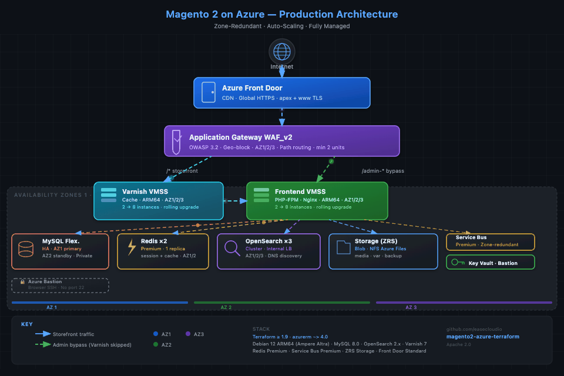

# Magento 2 Azure Terraform

[](https://www.terraform.io)
[](https://registry.terraform.io/providers/hashicorp/azurerm/latest)
[](LICENSE)
[](https://github.com/easecloudio/magento2-azure-terraform/actions/workflows/terraform-ci.yml)



Production-ready, zone-redundant Magento 2 infrastructure on Microsoft Azure — provisioned entirely with Terraform. All configuration lives in a single YAML file per environment; no `.tfvars` files needed.

**Developed and maintained by [EaseCloud](https://easecloud.io)** — cloud-native, AI-driven, and data infrastructure solutions.

## What this provisions

| Tier | Service | Details |
|---|---|---|
| CDN | Azure Front Door Standard | Global edge, HTTPS, managed TLS for apex + www |
| Ingress | Application Gateway WAF_v2 | OWASP 3.2, geo-blocking, path-based routing, autoscale |
| Cache | Varnish VMSS | ARM64 Ampere Altra, rolling upgrades, AZ1/2/3 |
| App | Frontend VMSS | PHP-FPM + Nginx, ARM64, rolling upgrades, AZ1/2/3 |
| Database | MySQL Flexible Server | Zone-redundant standby, private VNet, Magento-tuned parameters |
| Cache | Azure Cache for Redis ×2 | Premium with 1 replica per primary, AZ1/2 spread |
| Search | OpenSearch 3-node cluster | Self-hosted, internal LB, AZ1/2/3, DNS-based discovery |
| Queue | Azure Service Bus Premium | Zone-redundant, partitioned namespace |
| File | Azure Files NFS | `var/` and `media/` shares, ZRS replication |
| Object | Azure Blob Storage | Media, system, backup containers, ZRS replication |
| Secrets | Azure Key Vault | Auto-generated passwords, managed-identity access |
| Identity | User-assigned Managed Identity | Passwordless access from VMSS to Key Vault and Blob |
| DNS | Azure DNS zone | Apex alias to Front Door, www CNAME, NS delegation output |
| Events | Azure Event Grid | Release deployment trigger on Blob upload |
| Access | Azure Bastion | Browser SSH to private VMs without opening port 22 |
| Observability | Azure Monitor | CPU, 5xx, MySQL storage, Redis memory alerts |
| Cost | Azure Consumption Budget | Forecasted + actual spend alerts |

---

## Architecture

```
                           Internet
                               │
                      Azure Front Door
                   (CDN · HTTPS · apex + www)
                               │
             Azure Application Gateway WAF_v2
             (OWASP 3.2 · Geo-block · AZ1/2/3)
                    │                    │
         /* (storefront)        /admin-* (bypass Varnish)
                    │                    │
             Varnish VMSS                │
           (AZ1 · AZ2 · AZ3)            │
                    │                    │
             ┌──────┴────────────────────┘
             │
         Frontend VMSS
       (PHP-FPM · Nginx · AZ1/2/3)
             │
     ┌───────┼────────────────────────────────┐
     │       │                │               │
  MySQL    Redis ×2      OpenSearch        Azure Files
  Flex.    Premium       3-node cluster    NFS (ZRS)
  Server   Replica       (AZ1/2/3 +
  HA       (AZ1/2)        Internal LB)
  AZ1+2
  standby
     │
  Blob Storage (ZRS)
  Service Bus Premium
  Key Vault
  Azure Bastion
```

### Zone redundancy

Every tier is spread across at least two Azure Availability Zones:

| Service | Zone coverage |
|---|---|
| Varnish VMSS | AZ1, AZ2, AZ3 |
| Frontend VMSS | AZ1, AZ2, AZ3 |
| Application Gateway | AZ1, AZ2, AZ3 |
| MySQL Flexible Server | Primary AZ1, Standby AZ2 |
| Redis (session + cache) | AZ1, AZ2 (primary + replica) |
| OpenSearch cluster | Node 0 AZ1, Node 1 AZ2, Node 2 AZ3 |
| Blob Storage | ZRS (3 AZs synchronous) |
| Azure Files NFS | ZRS (3 AZs synchronous) |
| Service Bus | Premium zone-redundant |

### Traffic routing

Storefront (`/*`) and admin (`/admin-*`) use separate App Gateway backend pools:

- **Storefront:** Front Door → App Gateway → Varnish VMSS → Frontend VMSS
- **Admin panel:** App Gateway → Frontend VMSS directly (Varnish bypassed; admin pages are never cached)

The admin path is a randomly generated string stored in Key Vault (`admin-path`), providing security through obscurity on top of optional IP restriction via `waf.admin_allowed_ips`.

---

## Prerequisites

- Terraform >= 1.9
- Azure CLI (`az`) installed and authenticated
- An Azure subscription with sufficient quota for:
  - VMSS (Dpdsv5 family, ARM64)
  - MySQL Flexible Server (GeneralPurpose tier)
  - Azure Cache for Redis Premium
  - Azure Application Gateway WAF_v2
  - Azure Bastion Standard
  - Azure Front Door Standard

### Authentication

**Local development**

```bash
az login
az account set --subscription "<your-subscription-id>"
```

**CI / automated pipelines** — set these environment variables:

| Variable | Description |
|---|---|
| `ARM_CLIENT_ID` | Service principal application (client) ID |
| `ARM_CLIENT_SECRET` | Service principal client secret |
| `ARM_SUBSCRIPTION_ID` | Target Azure subscription ID |
| `ARM_TENANT_ID` | Azure Active Directory tenant ID |

---

## Remote State (recommended)

Before first use, provision a storage account for Terraform state and copy the backend template:

```bash
# Create the state storage account (one-time, done outside Terraform)
az group create -n tfstate-rg -l eastus
az storage account create -n <unique-name> -g tfstate-rg --sku Standard_LRS
az storage container create -n tfstate --account-name <unique-name>

# Copy and fill in the backend config
cp backend.tf.example backend.tf
# Edit backend.tf: set storage_account_name to <unique-name>

# Re-initialise with the remote backend
terraform init -reconfigure
```

`backend.tf` is listed in `.gitignore` — it must not be committed.

---

## Quick Start

```bash
# 1. Clone
git clone https://github.com/easecloudio/magento2-azure-terraform.git
cd magento2-azure-terraform

# 2. Copy and edit the developer config
cp developer.config.yaml my-project.config.yaml
# Edit: set brand, codename, domain, admin_email,
#       azure.subscription_id, azure.resource_group, ssh_public_key

# 3. (Optional) Configure remote state — see Remote State section above

# 4. Initialise Terraform
terraform init

# 5. Create a workspace matching your config file name
terraform workspace new developer

# 6. Plan and apply
terraform plan -out developer.plan
terraform apply developer.plan

# 7. Delegate DNS
terraform output dns_zone_name_servers
# Add the returned NS records at your domain registrar.
# Front Door issues managed TLS certificates once delegation is active.
```

---

## Configuration Reference

All settings live in `<workspace>.config.yaml`. Copy `developer.config.yaml` as a starting point.

### Identity

| Key | Description |
|---|---|
| `brand` | Short brand identifier used in all resource names |
| `codename` | Project codename — combined with brand as `brand-codename` |
| `github_repo` | Source repository (used in tags and automation) |
| `domain` | Primary domain for DNS and TLS certificates |
| `admin_email` | Address for budget and monitoring alerts |

### Azure

| Key | Description |
|---|---|
| `azure.subscription_id` | Target Azure subscription ID |
| `azure.location` | Azure region (e.g. `eastus`) |
| `azure.resource_group` | Resource group name to create or reuse; defaults to `brand-codename-rg` |

### Networking

| Key | Description |
|---|---|
| `vnet.cidr_block` | VNet IP range (e.g. `172.35.0.0/16`) |

The VNet is subdivided into five `/20` subnets automatically: compute, data, gateway, MySQL delegation, and AzureBastionSubnet.

### Compute (VMSS)

| Key | Description |
|---|---|
| `vmss.frontend.vm_size` | Azure VM size for frontend (e.g. `Standard_D4ps_v5`) |
| `vmss.frontend.os_disk_size_gb` | OS disk size in GB |
| `vmss.frontend.desired_capacity` | Target instance count |
| `vmss.frontend.min_count` | Autoscale minimum |
| `vmss.frontend.max_count` | Autoscale maximum |
| `vmss.varnish.vm_size` | Azure VM size for Varnish (e.g. `Standard_D2ps_v5`) |
| `vmss.varnish.os_disk_size_gb` | OS disk size in GB |
| `vmss.varnish.desired_capacity` | Target instance count |
| `vmss.varnish.min_count` | Autoscale minimum |
| `vmss.varnish.max_count` | Autoscale maximum |
| `autoscale.cooldown_minutes` | Minutes between scaling actions |
| `autoscale.out_threshold_percent` | CPU % that triggers scale-out |
| `autoscale.in_threshold_percent` | CPU % that triggers scale-in |

Both VMSS pools are spread across AZ1, AZ2, and AZ3 automatically.

### MySQL

| Key | Description |
|---|---|
| `mysql.sku` | Flexible Server SKU (e.g. `GP_Standard_D2ds_v4`) |
| `mysql.storage_gb` | Initial storage in GB (auto-grow enabled) |
| `mysql.backup_retention_days` | Automated backup retention in days |
| `mysql.engine_version` | MySQL version (e.g. `8.0.21`) |
| `mysql.admin_login` | Administrator username |
| `mysql.high_availability` | `true` = zone-redundant standby in AZ2; `false` = single server |
| `mysql.parameters` | List of `{name, value}` server parameter overrides |

The server is VNet-integrated (private subnet, no public endpoint). Geo-redundant backups are enabled automatically in staging and production workspaces.

### Redis

| Key | Description |
|---|---|
| `redis.sku` | Cache tier (use `Premium` for HA) |
| `redis.family` | Family matching the SKU (`P` for Premium) |
| `redis.capacity` | Cache size within the family |
| `redis.name` | List of instance names to create (default: `session`, `cache`) |

Premium instances are provisioned with `replicas_per_primary = 1` and zone-spread across AZ1 and AZ2.

### OpenSearch

Self-hosted OpenSearch runs as a 3-node cluster (one node per AZ) behind an internal Azure Load Balancer on port 9200. Nodes are configured to discover each other via private DNS.

| Key | Description |
|---|---|
| `opensearch.vm_size` | VM size for each OpenSearch node (e.g. `Standard_D2ps_v5`) |
| `opensearch.disk_size_gb` | OS disk size per node in GB |
| `opensearch.version` | OpenSearch version to install (e.g. `2.17.0`) |

### Service Bus

| Key | Description |
|---|---|
| `service_bus.sku` | Namespace tier (`Premium` recommended for production) |

Premium tier enables zone redundancy and message partitioning.

### Storage

| Key | Description |
|---|---|
| `blob_storage.containers` | Blob container names (media, media-optimized, system, backup) |
| `azure_files.shares.var.quota_gb` | Quota for the `var/` NFS share |
| `azure_files.shares.media.quota_gb` | Quota for the `media/` NFS share |

Both the blob account and the NFS account use ZRS replication (zone-redundant).

### WAF

| Key | Description |
|---|---|
| `waf.restricted_countries` | ISO 3166-1 alpha-2 country codes to block at the WAF |
| `waf.admin_allowed_ips` | Optional list of CIDR ranges allowed to access the admin path (e.g. `["1.2.3.4/32"]`). Empty list = unrestricted. |

### Budget

| Key | Description |
|---|---|
| `budget.amount` | Monthly spend limit in USD |
| `budget.threshold_percent` | Alert when actual spend reaches this % of the budget |
| `budget.start_date` | Budget period start in RFC3339 format (`2026-06-01T00:00:00Z`) |

A second alert fires at 75% of the budget based on forecasted spend.

---

## Workspaces

Terraform workspaces map directly to config files. A validation check at plan time enforces valid workspace names.

| Workspace | Config file | Key differences |
|---|---|---|
| `developer` | `developer.config.yaml` | Key Vault purge protection off, geo-redundant backup off |
| `staging` | `staging.config.yaml` | Key Vault purge protection on, geo-redundant backup on |
| `production` | `production.config.yaml` | Key Vault purge protection on, geo-redundant backup on |

```bash
# Create a workspace
terraform workspace new developer

# Switch workspaces
terraform workspace select staging

# List workspaces
terraform workspace list
```

---

## Accessing VMs

SSH is blocked at the NSG layer. Use Azure-native methods instead.

### Azure Bastion (browser SSH)

Bastion is provisioned in the `AzureBastionSubnet` automatically. Connect without opening port 22:

```bash
az network bastion ssh \
  --name <project>-bastion \
  --resource-group <resource-group> \
  --target-resource-id <vm-resource-id> \
  --auth-type ssh-key \
  --username <brand> \
  --ssh-key ~/.ssh/id_rsa
```

Find the VM resource ID:

```bash
az vm list -g <resource-group> --query "[].{name:name, id:id}" -o table
```

### Run-command (no network path needed)

```bash
az vmss run-command invoke \
  --resource-group <resource-group> \
  --name <project>-frontend-vmss \
  --instance-id 0 \
  --command-id RunShellScript \
  --scripts "systemctl status nginx"
```

---

## Release Deployment

Releases are triggered by uploading a versioned artifact to Blob Storage:

```
system/release/<version>.tar.gz
```

Azure Event Grid watches the `system` container for `BlobCreated` events matching the `release/` prefix and delivers them to a Storage Queue (`release-events`). A worker process on each VMSS instance polls the queue and executes the deployment. Wire the worker to poll `release-events` during Ansible provisioning.

---

## Secrets and Key Vault

The following secrets are auto-generated and stored in Key Vault at first `terraform apply`:

| Secret name | Content |
|---|---|
| `mysql-password` | MySQL administrator password |
| `redis-password` | Redis authentication password |
| `admin-path` | Magento admin URL segment (e.g. `abc123admin`) |
| `health-check` | Health probe path segment |
| `security-header` | UUID used as a shared secret header between App Gateway and Varnish |

The compute Managed Identity has `Get` + `List` access. Retrieve secrets from within a VM:

```bash
az keyvault secret show \
  --vault-name <vault-name> \
  --name mysql-password \
  --query value -o tsv
```

---

## Security

- **Network isolation** — all backend services (MySQL, Redis, OpenSearch) are private-subnet only; no public endpoints
- **WAF** — OWASP 3.2 managed rule set in Prevention mode, geo-blocking, optional admin IP restriction
- **TLS everywhere** — Front Door issues managed certificates for both apex and `www`; App Gateway receives traffic from Front Door over HTTP internally
- **Secrets** — all credentials are randomly generated, never in source control, and stored in Key Vault with Managed Identity access
- **NSG scoping** — compute subnet accepts HTTP only from the gateway subnet; data subnet accepts MySQL/Redis/OpenSearch/transport only from the compute subnet
- **Purge protection** — Key Vault purge protection is enabled in staging and production; disabled only in developer for easier teardown

---

## Monitoring

Azure Monitor alerts are pre-configured and notify `admin_email`:

| Alert | Condition | Severity |
|---|---|---|
| Frontend CPU high | Average CPU > 85% for 5 min | Warning |
| Varnish CPU high | Average CPU > 85% for 5 min | Warning |
| App Gateway 5xx | Failed requests > 10/min | Critical |
| MySQL storage high | Storage utilisation > 80% | Warning |
| Redis memory high | Used memory > 80% | Warning |
| Budget (forecasted) | Forecasted spend > 75% of limit | Informational |
| Budget (actual) | Actual spend > threshold% of limit | Informational |

---

## Outputs

After `terraform apply`, the following values are available:

```bash
terraform output load_balancer_ip          # App Gateway public IP
terraform output frontdoor_hostname        # Front Door CDN endpoint
terraform output mysql_endpoint            # MySQL private FQDN
terraform output redis_endpoints           # Redis hostnames (session + cache)
terraform output blob_storage_account_name # Blob storage account name
terraform output nfs_storage_account_name  # NFS storage account name
terraform output dns_zone_name_servers     # Nameservers to set at your registrar
terraform output project                   # Derived project name (brand-codename)
terraform output environment               # Active workspace name
```

---

## File Structure

```
.
├── provider.tf            # Terraform + azurerm provider config
├── locals.tf              # Derived locals, workspace validation
├── data.tf                # Azure client config data source
├── random.tf              # Password and string generation
├── vpc_network.tf         # VNet, subnets (compute/data/gateway/mysql/bastion)
├── security_groups.tf     # NSGs per subnet tier
├── identity.tf            # User-assigned Managed Identity + role assignments
├── compute.tf             # Varnish + Frontend VMSS, autoscale
├── load_balancer.tf       # App Gateway WAF_v2, WAF policy, path-based routing
├── cdn.tf                 # Azure Front Door profile, endpoint, custom domains
├── dns.tf                 # Azure DNS zone, apex alias, www CNAME, TXT validation
├── database.tf            # MySQL Flexible Server (private, zone-redundant HA)
├── cache.tf               # Azure Cache for Redis ×2 (Premium, replica, zones)
├── search.tf              # OpenSearch 3-node cluster + internal LB
├── filesystem.tf          # Azure Files NFS shares (var/, media/)
├── storage.tf             # Blob Storage + Storage Queue (ZRS)
├── queue.tf               # Service Bus Premium namespace + queue
├── events.tf              # Event Grid subscription for release deploys
├── secrets.tf             # Key Vault + secrets
├── service_discovery.tf   # Private DNS zone + VNet link
├── bastion.tf             # Azure Bastion host
├── monitoring.tf          # Azure Monitor alerts
├── budget.tf              # Azure Consumption Budget
├── outputs.tf             # Terraform outputs
├── cloud-init/
│   ├── frontend.sh        # Bootstrap for frontend VMSS (installs Ansible, Azure CLI)
│   ├── varnish.sh         # Bootstrap for Varnish VMSS
│   └── opensearch.sh      # Bootstrap for OpenSearch nodes (cluster config)
├── backend.tf.example     # Remote state backend template (copy to backend.tf)
└── developer.config.yaml  # Reference config (copy per environment)
```

---

## About EaseCloud

EaseCloud is a cloud consulting and solutions company specializing in:

- Cloud-native application development
- AI & automation integrations
- DevOps and infrastructure management
- Magento 2 hosting and platform engineering

We built this project to provide a production-grade, open-source Azure infrastructure baseline for Magento 2 — demonstrating our expertise in cloud architecture, security, and automation.

If your team is scaling Magento 2 on Azure or needs help with infrastructure design, deployment pipelines, or managed support, [get in touch](https://easecloud.io).

📧 [support@easecloud.io](mailto:support@easecloud.io)
🌐 [easecloud.io](https://easecloud.io)

---

## Bug Reports & Issues

Found a bug or have a feature request?

🐛 [Create a GitHub issue](https://github.com/easecloudio/magento2-azure-terraform/issues)

Please include:
- Terraform version (`terraform version`)
- Azure provider version
- Workspace name and relevant config excerpt (redact credentials)
- Steps to reproduce
- Expected vs actual behavior
- Any error messages from `terraform plan` or `terraform apply`

---

## Contributing

1. Fork the repository
2. Create a feature branch from `main`
3. Follow the commit message convention: `type: short description` (e.g. `fix:`, `feat:`, `docs:`)
4. Ensure `terraform fmt -check` and `terraform validate` pass (CI enforces this)
5. Open a pull request against `main`

All infrastructure changes should be validated with `terraform validate` before submission. Destructive changes (removing resources, changing SKUs that force replacement) should be noted explicitly in the PR description.

---

## License

Apache 2.0 — see [LICENSE](LICENSE)
